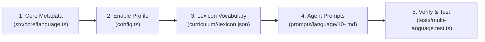

# Adding a New Language to LangHarness

LangHarness is designed with a fully modular, decoupled multi-language architecture. Each target language maintains isolated learning records, FSRS spaced repetition decks, knowledge graph ledgers, and conversation histories under `<data>/profiles/<language>/`.

Adding a new language is deterministic, fast, and token-efficient. This guide details the architecture, schemas, and a 5-step checklist for learners, developers, and AI agents.

---

## 1. Multi-Language Architecture Overview

- **Zero-Shift Scalable UI**: The language switcher in the sidebar uses an anchored dropdown menu (`MenuShell`) and a centered modal confirmation dialog (`SwitchConfirmDialog`). Switching languages restarts the backend server in the selected profile without disturbing or shifting the main navigation (`Today`, `Plan`, `Review`, `Skill map`, `Words`).
- **Profile Data Isolation**: All learner data (chats, cards, SRS intervals, graph nodes) is isolated in `<data>/profiles/<language>/`. Slovak and new languages never mix data.
- **Universal Diacritic Folding & Slip Detection**: `foldDiacritics(text)` uses Unicode NFD canonical decomposition (`\p{M}+` stripping) and NFKC normalization. It works out-of-the-box across Latin, Cyrillic, Greek, and other accented scripts.
- **Backwards-Compatible Schema**: Lexicon entries support both `lemma` and `text` (generic) alongside backwards-compatible legacy aliases (`sk`).
- **Graceful Asset Fallback**: If a newly added language doesn't have curated sound pairs or scene scripts yet, the system returns empty safe fallbacks without throwing errors.

---

## 2. The 5-Step Checklist to Add a Language



### Step 1: Register Language Metadata in `src/core/language.ts`

In `src/core/language.ts`, update `LanguageId` and add the language configuration to `LANGUAGES`.

> [!TIP]
> LangHarness exports pre-configured `LANGUAGE_PRESETS` for **Czech (`czech`)**, **Romanian (`romanian`)**, **German (`german`)**, and **Spanish (`spanish`)**. You can simply copy a preset into `LANGUAGES`.

```typescript
export type LanguageId = "slovak" | "russian" | "czech"; // add new id

export const LANGUAGES: Record<LanguageId, LanguageInfo> = {
  // ... existing languages ...
  czech: {
    id: "czech",
    tag: "cs-CZ",          // BCP-47 tag for TTS and browser SpeechSynthesis
    code: "cs",           // ISO 639-1 code
    endonym: "Čeština",   // Native endonym displayed in the UI
    english: "Czech",     // English name
    specialLetters: ["á", "č", "ď", "é", "ě", "í", "ň", "ó", "ř", "š", "ť", "ú", "ů", "ý", "ž"],
    edgeVoices: ["cs-CZ-VlastaNeural", "cs-CZ-AntoninNeural"], // Microsoft Edge TTS neural voices
    referenceSite: {
      label: "Wiktionary",
      baseUrl: "https://cs.wiktionary.org",
    },
  },
};
```

### Step 2: Enable the Profile in `config.ts`

In `config.ts`, add the language ID to `LANGUAGE_PROFILES`:

```typescript
export const LANGUAGE_PROFILES = ["slovak", "russian", "czech"] as const;
```

*(Note: `tests/langharness.test.ts` pins `LANGUAGE_PROFILES` in `config.ts` and `LANGUAGE_IDS` in `src/core/language.ts` to ensure exact parity.)*

### Step 3: Create Curriculum Lexicon in `curriculum/<lang>/lexicon.json`

Create the folder `curriculum/<lang>/` and add `lexicon.json`.

Each entry in the lexicon array must follow this JSON schema:

```json
[
  {
    "slug": "dekuji",
    "lemma": "děkuji",
    "pos": "verb",
    "en": "thank you; I thank",
    "examples": [
      {
        "text": "Děkuji moc za pomoc.",
        "en": "Thank you very much for the help.",
        "cloze": {
          "answer": "Děkuji",
          "at": 0
        }
      }
    ]
  },
  {
    "slug": "kava",
    "lemma": "káva",
    "pos": "noun",
    "en": "coffee",
    "gender": "f",
    "declension": {
      "nom": "káva",
      "gen": "kávy",
      "dat": "kávě",
      "acc": "kávu",
      "loc": "kávě",
      "ins": "kávou"
    },
    "examples": [
      {
        "text": "Mám rád černou kávu.",
        "en": "I like black coffee.",
        "cloze": {
          "answer": "kávu",
          "at": 15
        }
      }
    ]
  }
]
```

#### Cloze Validation Rules
- `cloze.answer`: Must match the exact inflected form as it appears inside `text`.
- `cloze.at`: The 0-based character index where `cloze.answer` starts in `text` (`text.slice(at, at + answer.length) === answer`).

### Step 4: (Optional) Add Teaching Prompts in `prompts/language/`

If you want custom agent instructions for how the AI teacher introduces grammar, explains phonology, or guides drills for this language, create:

`prompts/language/10-<language>.md`

Example for Czech (`prompts/language/10-czech.md`):
```markdown
# Czech Language Instructions

- Target language is Czech (čeština).
- Pay close attention to vocalic r/l, ř pronunciation, and vowel length (čárka / kroužek).
- In explanations, always provide English glosses alongside Czech sentences.
- When correcting diacritic slips (e.g. e vs ě, u vs ů/ú), point out the grammatical significance.
```

### Step 5: Verify & Run the Test Suite

Run the multi-language test suite:

```bash
npm test tests/multi-language.test.ts
npm test tests/langharness.test.ts
```

All 42+ unit tests will verify:
1. `LANGUAGE_PROFILES` and `LANGUAGE_IDS` matching.
2. Diacritic folding and slip detection.
3. Lexicon loading and cloze card minting.
4. Clean UI mounting and server restart endpoints.

---

## 3. Ready-To-Use Presets in `src/core/language.ts`

LangHarness already contains pre-configured presets in `LANGUAGE_PRESETS`:
- **`czech`**: `cs-CZ`, `cs-CZ-VlastaNeural` / `AntoninNeural`, Czech diacritics including `ř`, `ě`, `ů`.
- **`romanian`**: `ro-RO`, `ro-RO-AlinaNeural` / `EmilNeural`, Romanian diacritics `ă`, `â`, `î`, `ș`, `ț`, DEXonline reference.
- **`german`**: `de-DE`, `de-DE-KatjaNeural` / `ConradNeural`, German umlauts `ä`, `ö`, `ü`, `ß`.
- **`spanish`**: `es-ES`, `es-ES-ElviraNeural` / `AlvaroNeural`, Spanish inverted punctuation `¿`, `¡`, and `ñ`.

To activate any of them, copy from `LANGUAGE_PRESETS` to `LANGUAGES` and add the key to `LANGUAGE_PROFILES`.
